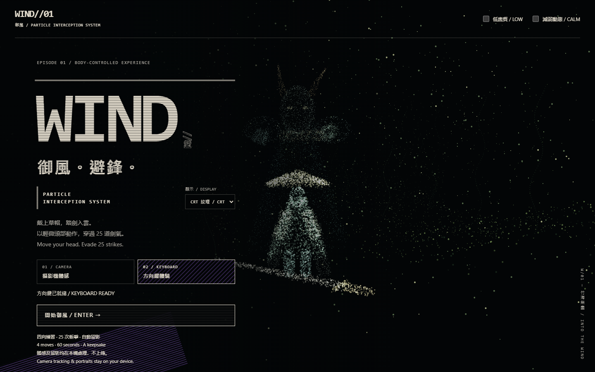
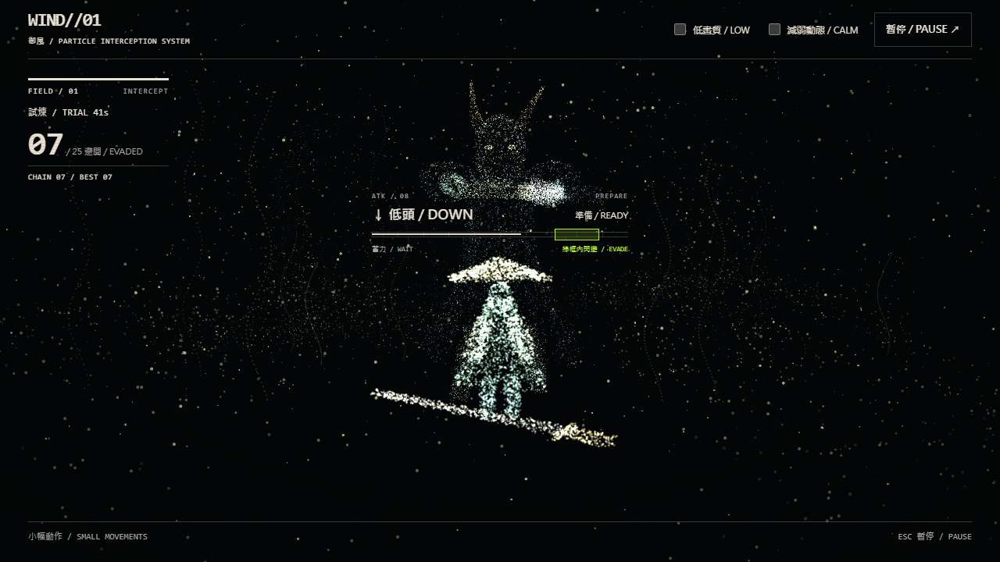
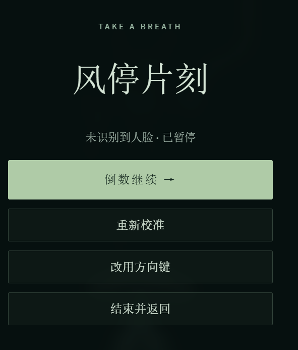

# WIND//01 — PARTICLE INTERCEPTION SYSTEM

御風 · Windborne

**Assignment 3: An interactive experience** — an individual browser project.

**[Play online / 線上體驗](https://kuki-hill.github.io/WingBrone/)** · **[Source repository / 作業原始碼](https://github.com/Kuki-Hill/WingBrone)**

Use a desktop browser with WebGL. Allow camera access for head controls, or choose keyboard mode. The first visit downloads the bundled recognition model; portraits and camera frames stay on your device.

A straw-hatted sword rider faces 25 attacks in a flowing particle bamboo forest. Turn your head left/right or look up/down to dodge. At the end, receive a locally generated portrait card with your score and a mischievous review of your performance.

以頭部動作控制的御劍閃避體驗：四向練習 → 一分鐘試煉 → 成績、人臉留影與江湖吐槽。所有照片均在瀏覽器本機處理。介面採用繁體中文與英語。





These screenshots show the current production build without camera imagery. The home, HUD and chapter-card design is original; no anime assets are bundled. The default CRT treatment uses static scanlines, raster headings and partially filled blocks; small copy remains solid. The home DISPLAY selector and results CLASSIC/CRT button switch styles locally. Development UI fixtures and screenshot checks are documented in [current CRT and pacing review](docs/crt-review/README.md).

## Idea and intended user

For someone seated at a laptop trying body-based interaction for the first time. The aim is to make a small movement produce an understandable action, visible consequence, and a reason to try again. Keyboard controls let someone complete the same experience without a camera.

**Input → response → feedback:** a deliberate head turn crosses a calibrated threshold → the rider dodges → the attack checks the rider's position → a hit/dodge message, combo and score explain the result. At the end, the score determines a playful caption. Captions use game performance, not facial appearance or identity.

## Run locally

Requirements: **Node.js 22.12+** (tested with Node 24), npm, a desktop browser with WebGL. Camera mode needs a webcam and permission; keyboard mode does not.

```sh
git clone https://github.com/Kuki-Hill/WingBrone.git
cd WingBrone
npm ci
npm run dev
```

Open **http://127.0.0.1:5174/**. Keep the terminal running. On Windows, after installing dependencies, double-click `start-preview.cmd` to start the preview and open the browser. Keep its window open while playing; Ctrl+C stops the server. If the project's preview is already running, the launcher reuses it. After restarting the computer, launch it again before opening the local URL.

On Windows, stop this project's running preview before reinstalling dependencies with `npm ci`; otherwise its native build dependency can remain locked by the preview process.

```sh
npm test
npm run build
npx vite preview --host 127.0.0.1 --port 5174 --strictPort
```

The production files are in `dist/`. Opening `index.html` directly is not supported.

### Public deployment and assignment submission

GitHub Pages serves the HTTPS demo at **https://kuki-hill.github.io/WingBrone/**. The workflow in `.github/workflows/pages.yml` installs the locked dependencies with `npm ci`, runs tests, builds with `npm run build -- --base=/WingBrone/`, and deploys only `dist/` after a successful build. Pushes to `main` publish updates automatically; the workflow can also be run manually from GitHub Actions. Pages must use **Settings → Pages → Source: GitHub Actions**.

The repository-specific build base makes JavaScript, the face-recognition Worker, model and WASM files load beneath `/WingBrone/`. The local development command keeps its original root URL. The workflow uses GitHub's temporary deployment token and needs no committed API keys or separate service account. Deployment follows the [official Vite GitHub Pages guide](https://vite.dev/guide/static-deploy.html#github-pages).

For Canvas, submit the **public repository URL**, not just the playable link: **https://github.com/Kuki-Hill/WingBrone**. Source, required assets, screenshots, README, PROCESS, credits and existing development history remain in the repository. The demo is an additional way to try the work. Human trial observations and any remaining limitations are documented in `PROCESS.md`.

No API key, paid account or remote inference service is needed. The fixed-version MediaPipe model and WASM assets are included in `public/vision/` (approximately 26 MB). Runtime detection stays in the browser.

## Controls and main loop

1. Choose **攝影機體感 / CAMERA** (camera) or **方向鍵體驗 / KEYBOARD** (keyboard).
2. In camera mode, face the screen until calibration completes. The local preview shows face detection, direction strength and camera selection. Use small movements and keep your face in view.
3. Complete the four practice directions. In keyboard mode use **← → ↑ ↓**. In camera mode turn left/right or look up/down. Return to neutral before the next gesture.
4. During the 60-second, 25-attack trial, follow the direction arrow. Attack slots average 2.4 seconds and gradually accelerate; swing speeds still differ by attack type. The green **現在閃避 / GO** cue appears **one second before impact**; move then. A dodge remains displaced long enough to cover the attack. Mistakes do not end the trial early.
5. **Esc** pauses. Resume with a countdown, recalibrate, switch to keyboard or exit. Window blur, a hidden tab or lost tracking also pauses attacks and the clock.
6. Results show successful dodges out of 25, success rate and best combo. Download the PNG keepsake, open it to save, or retry.

The portrait is captured from the camera during the trial. Without a usable face capture, the card clearly states that no photo was taken; it still shows the score and caption.

## Screenshot

The screenshot below is a **real cropped pause/recovery screen supplied during an earlier author test**, not a newly verified screenshot of the latest particle scene. The tracking logic has since been revised. A current gameplay screenshot remains to be added before final submission.



## Error handling and fallback

- Camera denied, unavailable or model load failure: explain the error and offer keyboard mode.
- Worker error or timeout: automatically try local compatibility inference, without requesting the camera again.
- Missing face: pause; recovered tracking requires explicit confirmation before countdown/resume. Slow inference is distinguished from a missing face.
- Repeated start/input: no duplicate camera stream or queued long-press dodges.
- WebGL failure: show an explanation; keyboard mode still requires WebGL.
- No portrait available: produce an explicitly labelled no-photo scorecard.
- Failed image export: retain the result and offer a retry. A new run cannot receive a previous run's asynchronous image.

## Privacy

Camera frames and the selected portrait stay in page memory. There is no video recording, image upload or automatic disk save. The user chooses whether to download the PNG. Restarting, exiting or switching input clears the current portrait. Exiting or switching to keyboard stops camera tracks.

**Do not commit downloaded portrait cards or recordings of other people to this public repository.** The included screenshot contains no face or personal camera image.

## Implementation and limitations

Vite + React + TypeScript + Three.js / React Three Fiber, with MediaPipe Face Landmarker. All characters, weapons and scenery are procedural particles; no film stills or generated image assets are bundled.

- `src/game.ts`: input gating, trial timing, shared attack boundaries and scoring.
- `src/camera.ts`, `src/face.worker.ts`, `src/pose.ts`: local inference, fallback, lifecycle and common direction mapping.
- `src/Scene.tsx`, `src/ParticleActors.tsx`: particle world, rider and articulated giant opponent.
- `src/keepsake.ts`, `src/verdict.ts`: local portrait composition and score-based captions.

Desktop-first; no audio. The character animation is procedural. Webcam quality, lighting and device speed affect tracking and responsiveness. Compatibility inference can reduce frame rate. Tests simulate input delays but do not measure real end-to-end webcam latency. Current portrait output is 1280×1000, while the underlying webcam frame may be lower resolution.

## Validation and submission status

The latest implementation has **54 passing automated tests** and a passing TypeScript/Vite production build. Tests cover the mirrored sword poses and their safe dodge directions, gesture thresholds, pauses, attack timing, simulated input delay, camera fallback/cleanup, portrait capture and caption tiers.

The author confirmed the keyboard practice and earlier game-image PNG download in their browser, and reported camera direction, downward-response and latency issues that informed revisions. The newest portrait keepsake still needs manual verification.

A classmate who studies kendo tried the game and found the dodge direction hard to read from the opponent. The left/right attacks now use a two-handed sword cue. Dodge toward the raised tip when the blade turns red. For horizontal draws the opponent darts to either flank. Duck under a high draw and rise above a low draw. Each run varies the attack intervals and swing speeds, with shorter intervals later in the minute. The feedback and design changes are recorded in [PROCESS.md](PROCESS.md). Current production screenshots and automated keyboard/UI checks are included. A human playtest of the revised visual interface and live-camera export remains pending. See [CREDITS.md](CREDITS.md) for acknowledgements.

Repository: https://github.com/Kuki-Hill/WingBrone
Assignment deadline: **1 November 2026, 23:59 Hong Kong time**.


## Reversible CRT revision

Use `?theme=crt` or `?theme=classic` to explicitly choose a style. Without a theme query, the optional local preference is used (CRT is the default). Both styles play the same 25-attack game. The PNG keepsake follows the selected style, with all camera capture and composition staying on device.

The complete pre-revision state is retained at `checkpoint/pre-crt-25-20261102` (commit `f0c3208`). The local revision tag `revision/crt-25-20261102` identifies the reversible change. [Rollback details and validation](docs/crt-review/README.md) distinguish visual switching from undoing gameplay changes.
