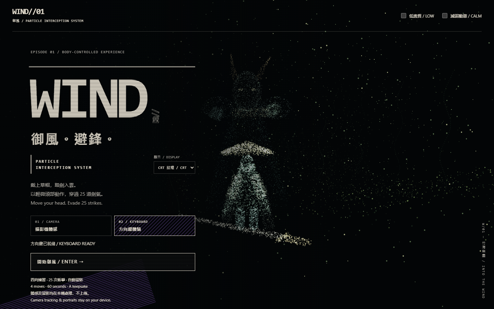
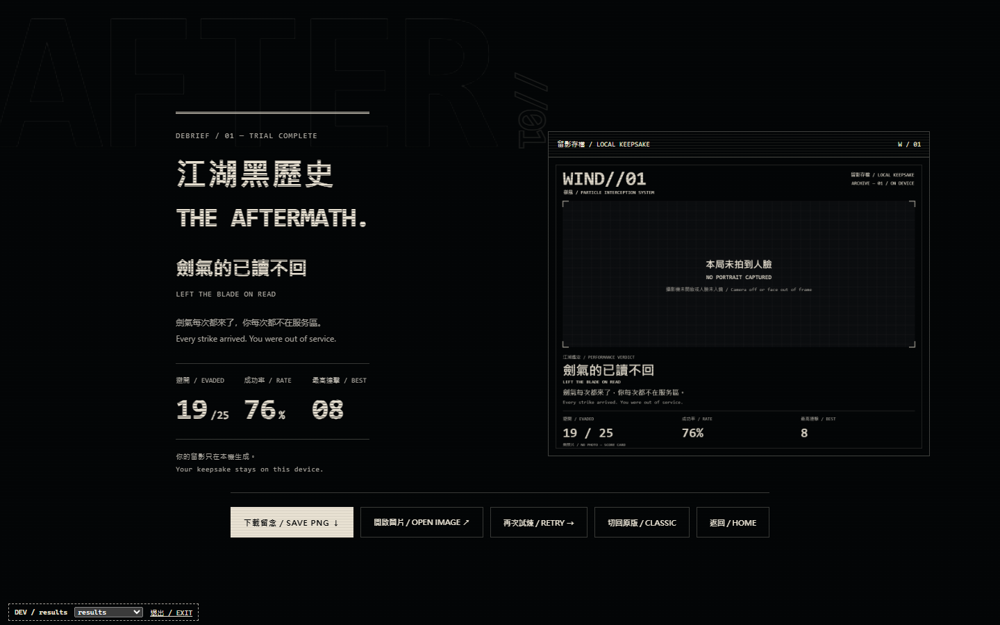
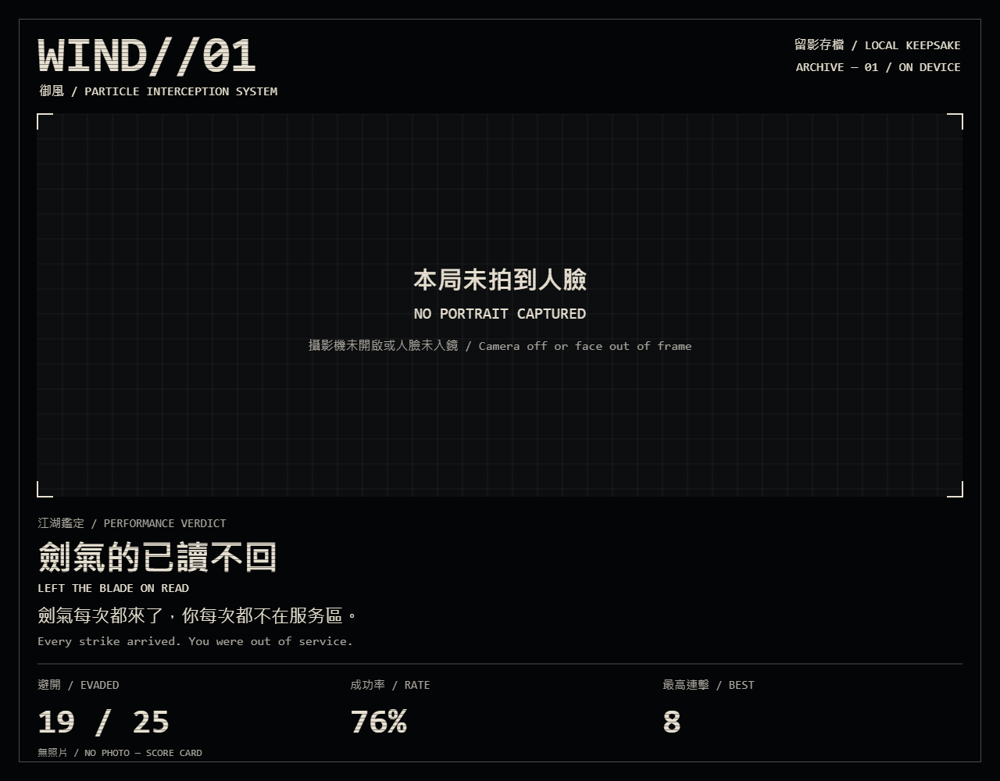

# CRT / 25-attack revision — 2 November 2026

The trial now contains **25 attacks in 60 seconds**. Keeping the original minute was an implementation assumption stated during the work. Slots average 2.4 seconds, with a gentle 2.7-to-2.1-second taper and random jitter. The faster diagonal stroke lasts 0.26–0.32 seconds; horizontal draws last 0.085–0.12 seconds. The green actionable warning is still one second before impact. Input thresholds, neutral rearming, collision boundaries, camera inference and attack choreography are unchanged.

`src/trialConfig.ts` supplies the count and duration to scheduling, HUD, percentages, bilingual grading and PNG output. Each direction occurs six or seven times; no three consecutive directions are identical. Grades use the same previous percentage bands: 25%, 50%, 75%, and a perfect score.

## Visual treatment

Home, results and PNG export share warm white on black, local monospace fonts, fine static raster gaps in large type, corner marks and partially filled blocks. Small body text and controls remain solid. The screen layer has no flashing, rolling scanlines, animated noise or chromatic jitter. Existing green/red semantics are preserved. Reduced-motion and forced-colour modes remain supported.







The results and share-card examples use development fixture data, not a person's image or a human test score. The PNG remains local. A synthetic colour-field portrait was used to verify containment, dimensions and margins without recording or sharing a face.

## Restore the earlier design

- On home, use **顯示 / DISPLAY → 原版 / CLASSIC**. Results also has **切回原版 / CLASSIC**. The preview and PNG change together. The optional local preference survives reloads; no account or upload is involved.
- `http://127.0.0.1:5174/?theme=classic` explicitly opens the earlier visual style. `?theme=crt` explicitly opens CRT. A URL choice takes priority over the stored preference on load.
- Style switching retains the **25-attack game**. To undo both pacing and visuals, the complete previous revision is preserved at `checkpoint/pre-crt-25-20261102`, commit `f0c3208`.
- The local tag `revision/crt-25-20261102` identifies this change. With a clean working tree, `git revert revision/crt-25-20261102` creates a new commit undoing it without rewriting development history. Rebuild afterward with `npm run build`.

The earlier CSS and classic PNG renderer remain available; `src/crt.css` scopes its overrides to `.theme-crt`. No font files, component libraries or raster assets were downloaded.

## Review and validation

Start Vite development on port 5175 as described in the earlier [UI review](../ui-review/README.md). The existing `?review=` states still work, with score fixtures clamped to 25. Append `&theme=crt` for consistent art direction. `&ui-only=1` is an additional **development-only** fixture that avoids allocating WebGL during panel comparisons; it does not activate in production.

```sh
playwright-cli -s=windcrt open http://127.0.0.1:5175/?review=home
playwright-cli -s=windcrt run-code --filename=tools/review-crt.js
playwright-cli -s=windcrt run-code --filename=tools/review-crt-export.js
playwright-cli -s=windcrt run-code --filename=tools/review-matrix.js
playwright-cli -s=windcrt run-code --filename=tools/review-baselines.js
```

Checks performed:

- **54 tests pass**, including successful completion of all 25 attacks at random timing extremes and simulated 0–300ms input delays; low-frame-rate catch-up and all-miss completion remain covered.
- TypeScript and production build pass. The pre-existing Three.js bundle-size warning remains.
- Six states checked at 1440×900, 1280×720 and 390×844: 18 full-scene captures, no horizontal overflow or render boundary error.
- Both styles and their switch controls checked at all three sizes. PNG preview updates and downloads in each style.
- Real browser keyboard practice progressed to the trial; the first seven attacks were dodged using the visible cue. The unattended remainder completed and produced 7/25, 28%, best combo 7. This is developer automation, not a new human trial.
- Synthetic 4:3 portrait export: 1280×1000 output, correct top/bottom orientation and uncropped margins. No real portrait was used.
- Twelve CRT UI baselines are stored separately in `baselines/`; the original baselines remain in `docs/ui-review/baselines/`. The comparison hides/omits WebGL, removes transient focus and animations, and compares decoded pixels. A maximum two-level channel difference is allowed for browser rounding; PNG metadata does not count as a visual change.

Early checks exposed an encoded-PNG mismatch despite identical pixels and intermittent browser navigation stalls after many scene allocations. The comparison now decodes pixels and uses the UI-only fixture for stable panel checks. Full particle-scene captures were reviewed separately in a fresh browser session.

Live webcam comfort and the perceived difficulty of 25 attacks still need human feedback. The tests validate timing and rendering; they do not measure real end-to-end camera latency.
